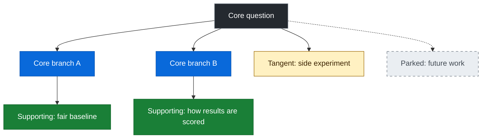

# Research Framework

A lightweight template for keeping a research project on **one core question**.

New ideas are welcome, but they have to earn their place. Each one is either linked back to the core question or **parked**, so tangents get written down instead of taking over the project.

## How to use it

1. **Write the core question.** Copy [`TEMPLATE.md`](TEMPLATE.md) and fill in the core question section: one sentence, why it matters, what counts as an answer, what's out of scope, the main measure of success, and your budget and time limits.
2. **Map the branches.** List every sub-question in the research map and give it a type: core, supporting, tangent or parked. Draw the tree.
3. **Run the rein-in test on every new idea.** Three questions decide whether you follow it, run it as a side experiment, note it as a limitation, or park it.
4. **Log evidence as you go.** Record whether each source supports or challenges a claim, and how close it is to your setup. For a challenging source, note what's different and what test would settle it.
5. **Keep the claims ledger honest.** Sort every claim into shown (your own results), expected (hypothesis or published research) or being tested. Never present expected or open (being tested) claims as shown.
6. **Check in at the checkpoints:** weekly, after new evidence, and before publishing. Update the map and park anything that has drifted.

See [`examples/evolving-review-councils.md`](examples/evolving-review-councils.md) for a filled-in example.

## The research map

Every branch hangs off the core question and is coloured by type.

| Type | Colour | Meaning |
|---|---|---|
| Core | Blue | Directly answers the core question. |
| Supporting | Green | Needed so a core result is fair and not misleading. |
| Tangent | Yellow | Interesting but won't change the answer. Run only as a small, separate side experiment. |
| Parked | Grey, dashed | Set aside for later: its own project, a side experiment or future work. |

## Files

| File | What it is |
|---|---|
| [`TEMPLATE.md`](TEMPLATE.md) | Blank template to copy for each project. |
| [`examples/evolving-review-councils.md`](examples/evolving-review-councils.md) | Worked example. |
| [`LICENSE`](LICENSE) | CC BY 4.0. |

## Licence

[Creative Commons Attribution 4.0 International (CC BY 4.0)](https://creativecommons.org/licenses/by/4.0/). You can share and adapt this, including commercially, as long as you give credit.
