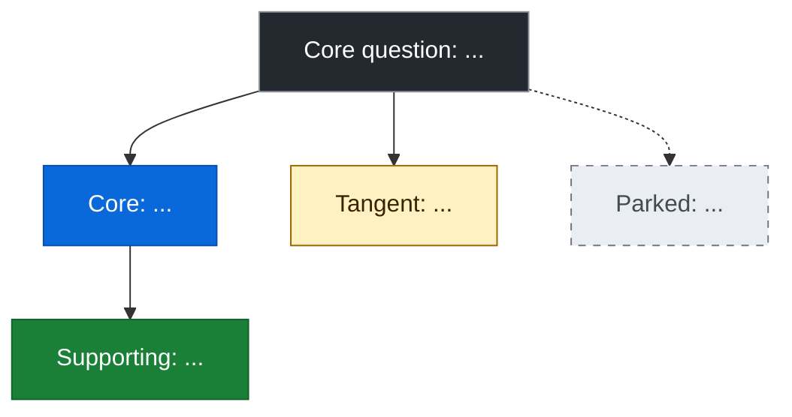

# [Project name]

> Copy this file for each project. Replace everything in [brackets].

## 1. Core question

| | |
|---|---|
| **Question** (one sentence) | [ ] |
| **Why it matters** | [ ] |
| **What counts as an answer** | [ ] |
| **Out of scope** | [ ] |
| **Main measure of success** | [ ] |
| **Budget and time limits** | [ ] |

## 2. Research map

**Types:** core (answers the question), supporting (keeps a core result fair), tangent (interesting but doesn't change the answer), parked (set aside).
**Status:** open, supported, challenged or parked.

| Branch | Type | How it links to the core question | Status | Next step |
|---|---|---|---|---|
| [ ] | core | [ ] | open | [ ] |
| [ ] | supporting | [ ] | open | [ ] |
| [ ] | tangent | [ ] | open | [ ] |
| [ ] | parked | [ ] | parked | [ ] |

## 3. Rein-in test

Ask these before following any new idea:

1. **Would it change the answer** to the core question?
2. **Would leaving it out make a result misleading or unfair?**
3. **Can I test it** with my current setup, budget and time?

- All three are no: **park it.**
- Only the third is no: **note it as a limitation.** Do the same if either of the first two is yes but you can't test it.
- First two are no, third is yes: **tangent.** Run it as a small side experiment kept separate, or park it.
- Otherwise, follow it: **core** if the first is yes, **supporting** if only the second is yes.

| Idea | Changes the answer? | Misleading if left out? | Testable now? | Decision |
|---|---|---|---|---|
| [ ] | [yes/no] | [yes/no] | [yes/no] | [follow / limitation / park] |

## 4. Evidence log

| Claim | Source link | Supports or challenges | How close to my setup | Confidence |
|---|---|---|---|---|
| [ ] | [ ] | [ ] | [close / partial / distant] | [high / medium / low] |

For each challenging source:

| Source | What's different from my setup | Test that would settle it |
|---|---|---|
| [ ] | [ ] | [ ] |

## 5. Objections ("why not just...?")

| Objection | Why it's fair | Test that answers it |
|---|---|---|
| Why not just [ ]? | [ ] | [ ] |

## 6. Claims ledger

**Rule: never present expected or open (being tested) claims as shown.**

| Shown (our own results) | Expected (hypothesis or published research, not yet tested by us) | Being tested (run planned or underway) |
|---|---|---|
| [ ] | [ ] | [ ] |

## 7. Parked ideas

| Idea | Why parked | Could become |
|---|---|---|
| [ ] | [ ] | [own project / side experiment / future work] |

## 8. Checkpoints

**Weekly**
- [ ] Is every open branch still linked to the core question?
- [ ] Has anything drifted that should be parked?
- [ ] Am I on budget and on time?

**After new evidence**
- [ ] Logged in the evidence log, with how close it is to my setup?
- [ ] Does it change any branch's status?
- [ ] If it challenges a claim, is there a test that would settle it?

**Before publishing**
- [ ] Every claim stated as shown is backed by our own results.
- [ ] Expected and open claims are labelled as such.
- [ ] Limitations and parked ideas are listed.
- [ ] Each "why not just...?" objection has an answer, or is listed as a limitation.
