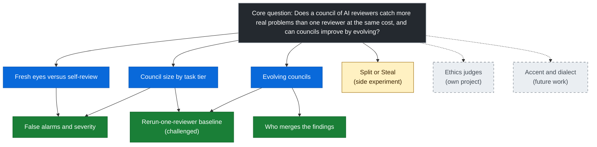

# Example: Evolving review councils

> A filled-in copy of [`TEMPLATE.md`](../TEMPLATE.md). It shows how the framework is used on a real question. Nothing in the claims ledger is shown yet; the results are still being tested.

## 1. Core question

| | |
|---|---|
| **Question** | Does a council of AI reviewers catch more real problems than one reviewer at the same cost, and can councils improve by evolving? |
| **Why it matters** | Multi-agent setups cost more. If the gain is only what you'd get by rerunning one reviewer, the extra structure isn't worth it. |
| **What counts as an answer** | A comparison at matched cost showing whether councils catch more real problems than one reviewer and than one reviewer rerun. Evolution is the second half: whether evolved councils beat hand-built ones on code they haven't seen. |
| **Out of scope** | Non-code review, training new models, and judging whether code is ethical. |
| **Main measure of success** | Real problems caught at the same cost, with serious and critical problems scored separately and false alarms counted against. |
| **Budget and time limits** | Same token budget per review for every setup. Total spend and timeline fixed before starting; rescope if either runs out. |

## 2. Research map

| Branch | Type | How it links to the core question | Status | Next step |
|---|---|---|---|---|
| Fresh eyes versus self-review | core | Tests whether a reviewer who didn't write the code catches more than the author checking its own work. | open | Run fresh and self-review on the same code at the same cost. |
| Council size by task tier | core | Councils may only pay off on hard or high-risk code, so size is tested per difficulty tier. Reviewers stay independent; a separate run lets them see each other's findings to measure anchoring. | open | Sort tasks into tiers; run sizes 1, 3 and 5 on each. |
| Evolving councils | core | Tests whether councils improve by evolving in a tournament. Includes all-generalist, all-specialist and mixed councils, so evolution shows whether specialisation earns its place. | open | Run the tournament; score winners on code they haven't seen. |
| Rerun-one-reviewer baseline | supporting | Without it, a council win could just be repeated sampling. A 2026 preprint challenges the claim that councils beat this baseline. | challenged | Compare each council against one reviewer rerun the same number of times at the same cost. |
| Who merges the findings | supporting | The merger decides what the author finally sees. A bad merger can drop the best catch or let a false alarm through. | open | Every council uses the same fixed, independent merger. Compare merger options separately. |
| False alarms and severity | supporting | Finding more isn't enough if most findings are noise, or if an average hides a missed critical flaw. | open | Score false alarms; score serious and critical findings separately. |
| Split or Steal | tangent | A cooperate-or-betray game. Would show how reviewers behave when they can cooperate or defect, but doesn't change the core answer. | open | Small side experiment after core runs, results kept separate. |
| Ethics judges | parked | Councils that judge ethics, not code problems. Different question. | parked | See parked ideas. |
| Accent and dialect | parked | Whether wording style in code or comments changes what reviewers flag. | parked | See parked ideas. |

## 3. Rein-in test

| Idea | Changes the answer? | Misleading if left out? | Testable now? | Decision |
|---|---|---|---|---|
| Rerun-one-reviewer baseline | no | yes | yes | Follow (supporting). |
| Who merges the findings | no | yes | yes | Follow (supporting). Fixed merger for all councils. |
| False alarms and severity | no | yes | yes | Follow (supporting). |
| Fixer quality (do fixes actually land?) | yes | yes | no | Limitation: we score findings, not fixes. |
| Split or Steal | no | no | yes | Tangent: side experiment only, kept separate. |
| Ethics judges | no | no | no | Park: own project. |
| Accent and dialect | no | no | no | Park: future work. |

## 4. Evidence log

| Claim | Source link | Supports or challenges | How close to my setup | Confidence |
|---|---|---|---|---|
| Multi-agent setups may just be expensive repeated sampling. | "Beyond Symmetric Agents" (2026 preprint), link to add | Challenges the claim that councils beat one reviewer rerun | Partial | Medium |

| Source | What's different from my setup | Test that would settle it |
|---|---|---|
| "Beyond Symmetric Agents" (2026) | It tested personas inside a debate, not specialist reviewers working independently with real task briefs. Related, but not the same. | Council versus one reviewer rerun the same number of times, same cost, same code. Include all-generalist councils to separate role effects from sampling. |

## 5. Objections ("why not just...?")

| Objection | Why it's fair | Test that answers it |
|---|---|---|
| Why not just rerun one reviewer several times? | A recent preprint suggests much of the gain may be repeated sampling. | Rerun-one-reviewer baseline at matched cost. |
| Why not just count findings? | More findings can mean more noise. | Score false alarms, and serious and critical findings separately. |
| Why not just let the tournament judge merge the findings? | The merger can drop catches or have its own blind spots. | One fixed, independent merger for all councils. Other options (the judge, keep everything, keep only findings two reviewers agree on, an evolving merger) are compared separately. |
| Why not just use specialists? | Roles might be persona prompting with extra cost. | Include all-generalist, all-specialist and mixed councils in tests and the tournament. |
| Won't evolved councils just overfit? | A tournament can learn its own test set. | Score winners on code they haven't seen. |
| Won't reviewers copy each other? | Anchoring can make a council act like one reviewer. | Reviewers stay independent; a separate run tests what happens when they see each other's findings. |

## 6. Claims ledger

| Shown (our own results) | Expected (hypothesis or published research, not yet tested by us) | Being tested (run planned or underway) |
|---|---|---|
| None yet. | Multi-agent gains may be repeated sampling (published, "Beyond Symmetric Agents", 2026). | Fresh eyes catch more than self-review. |
| | | Councils pay off mainly on hard or high-risk code. |
| | | Councils beat one reviewer, and one reviewer rerun, at the same cost. |
| | | Evolved councils beat hand-built ones on code they haven't seen. |
| | | Specialisation earns its place over generalists. |
| | | Merger choice changes what the author sees. |

## 7. Parked ideas

| Idea | Why parked | Could become |
|---|---|---|
| Ethics judges | A different question: judging ethics, not catching code problems. | Own project |
| Accent and dialect | Doesn't change the core answer and needs a new test set. | Future work |

## 8. Checkpoints

**Weekly**
- [ ] Every open branch still links to the core question.
- [ ] Split or Steal hasn't grown beyond a side experiment.
- [ ] Spend and timeline on track.

**After new evidence**
- [ ] Logged with how close it is to this setup.
- [ ] Rerun baseline status updated if it bears on repeated sampling.

**Before publishing**
- [ ] The shown column holds only our own results.
- [ ] The 2026 preprint is described accurately: personas in a debate, not independent specialist reviewers.
- [ ] Limitations listed: fixer quality not scored; main runs use one fixed merger; results hold only for the task tiers tested.
